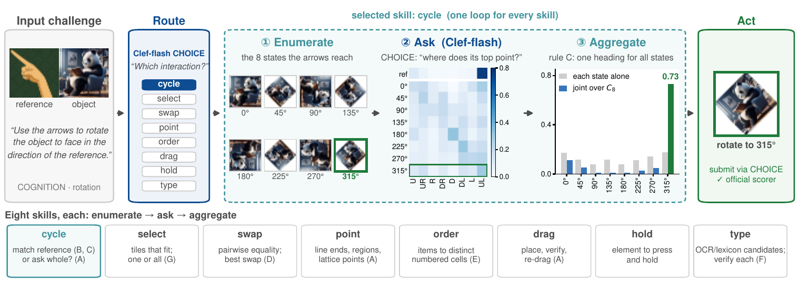
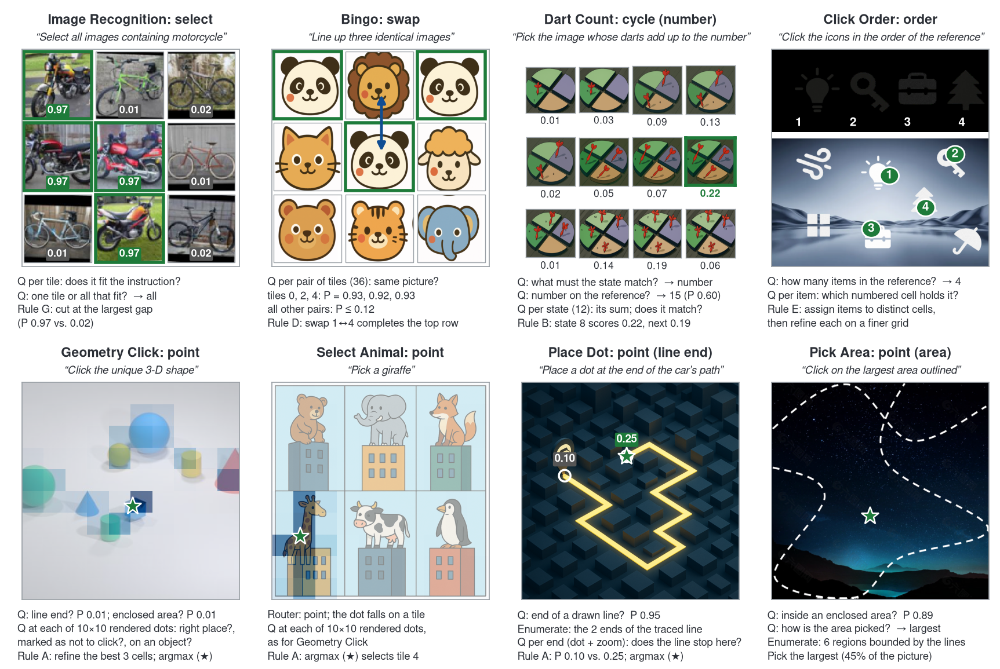
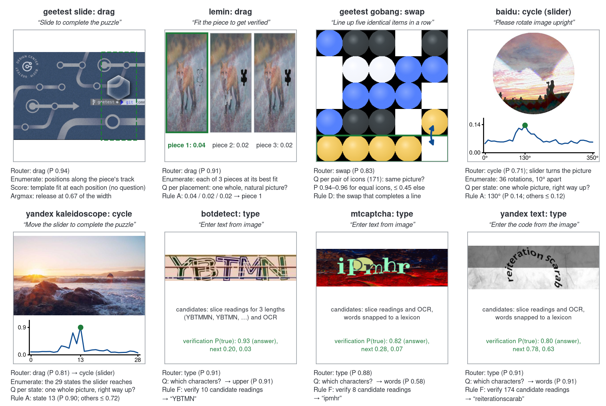

<div align="center">

# Enumerate, Ask, Aggregate: Structured Action Spaces Let Small Models Solve CAPTCHAs

[](https://huggingface.co/Cloudflare/clef-flash)
[](requirements.txt)
[](requirements.txt)
[](LICENSE)

</div>

<p align="center"></p>

<details>
<summary><b>Abstract</b> (click to expand)</summary>

Visual CAPTCHA solving is usually treated as open-ended generation: a large multimodal model interprets the challenge and generates executable actions. Many CAPTCHAs, however, have small, structured action spaces in which candidate solutions can be listed and checked one by one. We therefore ask whether small, locally deployed models can solve diverse visual CAPTCHAs without generating actions. We introduce *Enumerate–Ask–Aggregate*, a training-free framework that casts CAPTCHA solving as structured decision-making. Eight reusable interaction skills enumerate candidate actions, ask a 9B typed decision model closed questions about the candidates, and aggregate the resulting probabilities with structure-aware rules. Because candidate generation is separated from visual verification, a single local model handles diverse CAPTCHA interactions without task-specific fine-tuning. We evaluate on Open CaptchaWorld, COGNITION, Halligan and MCA-Bench. On new Open CaptchaWorld challenges, our method reaches 48.2% Pass@1, more than twice the 20.0% of a step-wise agent using the same 9B model. On additional COGNITION challenges, it reaches 76.0% Pass@1 and outperforms several frontier API models.

</details>

## 🚀 News

- **2026.11** Tools that re-run single challenges and record every closed question and its probabilities.
- **2026.11** Code, the frozen skill library and per-challenge results released.

## 🧠 Method

Eight interaction skills (`cycle`, `select`, `swap`, `point`, `order`, `drag`, `hold`, `type`) cover the widgets of the four benchmarks. A router picks the skill from the instruction, the picture and the kinds of controls on the page; the agent is not told the CAPTCHA family. The skill then

1. **enumerates** the actions the widget allows (states a button or slider reaches, tiles, swaps, lattice points, candidate strings),
2. **asks** the typed decision model [Clef-flash 9B](https://huggingface.co/Cloudflare/clef-flash) one closed question per candidate (yes/no or a choice among options, read off in one forward pass without generating text),
3. **aggregates** the probabilities with a fixed rule: verify-argmax (A), attribute match (B), joint inference over a rotation group (C), pairwise equality for swaps (D), assignment (E), generate-then-verify for text (F) or the largest gap for tile sets (G).

No model is fine-tuned.

## 📊 Results

Pass@1 (%), official scorers. **Held out**: challenges outside all development runs of the frozen library.

| Evaluation set | n | Ours (Clef-flash 9B) | Step-wise, same model | gpt-6-luna | gpt-5.6-terra | gpt-6-sol |
|---|:-:|:-:|:-:|:-:|:-:|:-:|
| Open CaptchaWorld, new challenges | 245 | **48.2** | 20.0 | 22.9 | 51.0 | 70.2 |
| COGNITION, outside main split | 75 | **76.0** | – | 44.0 | 50.7 | 54.7 |
| COGNITION, unseen families | 80 | 21.3 | – | 52.5 | 55.0 | 60.0 |
| MCA-Bench, test split | 2000 | 20.7 | – | 50.5 | 48.0 | 56.5 |

**Development sets**, against the best published result.

| Benchmark | n | Best published | Ours (Clef-flash 9B) | Ours (Qwen3.5-9B) |
|---|:-:|:-:|:-:|:-:|
| Open CaptchaWorld | 225 | 46.8 (CaptchaAgent, Gemini-2.5-Pro) | **59.6** | 48.4 |
| COGNITION, main split | 303 | 60.7 (GPT-5) | **62.4** | 46.2 |
| Halligan | 2600 | 60.7 (Halligan, GPT-4o) | **67.4** | 60.0 |

Every per-challenge result is in [`results/`](results); [`results/README.md`](results/README.md) lists the files and their totals.

## 🔍 Examples

Each panel shows a solved challenge, the closed questions the skill asked and the probabilities Clef-flash returned (recorded with `tools/trace_cognition.py` and `tools/trace_halligan.py`).

<p align="center"></p>
<p align="center"></p>

## ⚙️ Installation

```bash
git clone https://github.com/sgstq0811/JevCaptcha.git && cd JevCaptcha
pip install -r requirements.txt && playwright install chromium
export JEVCAPTCHA_ROOT=~/captcha_jev          # data root, see below
```

Clef-flash is downloaded from Hugging Face on first use. `code/tools.py` adds Florence-2 OCR candidates for the `type` skill (cached on disk).

## 🧩 Datasets

All paths are relative to `$JEVCAPTCHA_ROOT`.

| Benchmark | Source | Layout |
|---|---|---|
| Open CaptchaWorld | [GitHub](https://github.com/MetaAgentX/OpenCaptchaWorld) | paper version (225 challenges) in `ocw_v1_app/`, current release in `OpenCaptchaWorld/`; serve with `python app.py` |
| COGNITION | USENIX Security '26 artifact ([Zenodo 20406852](https://zenodo.org/records/20406852)) | `cognition/cognition-usenixsec26-artifact/`; `python code/cog_tasks.py dump results/cog_tasks.json` in the artifact's environment |
| Halligan | USENIX Security '25 benchmark ([Zenodo 15709075](https://zenodo.org/records/15709075)) | `data/halligan/bench/` |
| MCA-Bench | [Kaggle](https://www.kaggle.com/datasets/luffy798/mca-benchmultimodal-captchas) | dataset in `mca/`, official `tojson` outputs in `mca_json/` (`code/mca_build.py`) |

The `type` skill snaps words to a lexicon at `data/lexicon/american-english` (e.g. `/usr/share/dict/american-english`).

## 🛠️ Usage

**Open CaptchaWorld.** Start the official app (port 7861 for the paper version), then run the agent in a headless browser; the app's own `/api/check_answer` scores each challenge:

```bash
cd code
OCW_URL=http://127.0.0.1:7861 OCW_GT=$JEVCAPTCHA_ROOT/ocw_v1_app/captcha_data python ocw_skills.py --out ../results/ocw225.jsonl
```

**COGNITION.** Run the main split, then score with the artifact's `evaluate_pass1`:

```bash
ABL=count python cog_skills.py --split main --out ../results/cog_main.json
python cog_tasks.py score $PWD/../results/cog_tasks.json $PWD/../results/cog_main.json
```

`ABL=count` gives the frozen library of the paper; without it, the library adds the count-select mechanism written afterwards for the hole-counting family.

**Halligan.** All 26 families, scored with the benchmark's official verifier:

```bash
python hal_skills.py --out ../results/hal.jsonl
python hal_score_official.py ../results/hal.jsonl
```

**MCA-Bench.** Official test split, scored inline with the official rules:

```bash
python mca_skills.py --out ../results/mca.jsonl
```

**Other decision models and controls.** `--model Qwen/Qwen3.5-9B` runs the same library on a generative model (`GEN_SCORE=first` for first-token scoring). `ROUTE_FROM=<results file>` replaces the router with the routes of another run. `ABL=indep|top1|gap|assign|nover` replaces one aggregation rule with a naive one. Baselines: `ocw_generic.py` (step-wise agent), `cog_direct.py` and `mca_direct.py` (direct prompting), `api_direct.py` and `ocw_api_agent.py` (API models through an OpenAI-compatible endpoint in `API_BASE` with the key file in `API_KEY_FILE`), `cog_som.py` (Set-of-Mark control).

**Step-by-step traces.** Re-run single challenges and record every closed question, the number of candidates and the returned probabilities, together with the candidate images:

```bash
python tools/trace_cognition.py runs/trace_cog Dart_Count/dart_puzzle_10.json,Click_Order/image7.png
python tools/trace_halligan.py runs/trace_hal geetest/gobang:1,baidu:1,botdetect:1
```

## 📁 Code

| Path | Content |
|---|---|
| `code/ocw_skills.py` | skill library (`SkillAgent`) and the Open CaptchaWorld adapter (browser) |
| `code/cog_skills.py`, `code/hal_skills.py`, `code/mca_skills.py` | COGNITION, Halligan and MCA-Bench adapters (MCA-Bench held out: page description and answer format only) |
| `code/ocw_policy.py`, `code/hal_policy.py` | question templates, candidate generators and type-specific pipelines |
| `code/clef.py`, `code/gen_backend.py` | Clef / Clef-flash wrapper; the same interface on a generative VLM |
| `code/cog_tasks.py`, `code/hal_score_official.py`, `code/mca_tasks.py` | official task builders and scorers |
| `code/theory_data.py`, `code/theory_analysis.py` | records and analysis for the aggregation-rule checks |
| `tools/` | step-by-step traces of single challenges |

## 📣 Citation

```bibtex
@misc{sun2026enumerate,
  title  = {Enumerate, Ask, Aggregate: Structured Action Spaces Let Small Models Solve CAPTCHAs},
  author = {Sun, Shangquan},
  year   = {2026},
  howpublished = {\url{https://github.com/sgstq0811/JevCaptcha}}
}
```

## Acknowledgement

This code builds on [Open CaptchaWorld](https://github.com/MetaAgentX/OpenCaptchaWorld), [COGNITION](https://zenodo.org/records/20406852), [Halligan](https://zenodo.org/records/15709075), [MCA-Bench](https://www.kaggle.com/datasets/luffy798/mca-benchmultimodal-captchas), [Clef-flash](https://huggingface.co/Cloudflare/clef-flash) and [Florence-2](https://huggingface.co/florence-community/Florence-2-large).

## Responsible use

A general CAPTCHA solver weakens a security control. The code is released so that CAPTCHA designers can test new widgets against enumerate-and-verify solvers; use it only on benchmarks and systems you are authorised to test.

## 📬 Contact

Please open an issue, or email Shangquan Sun ([shangquansun@gmail.com](mailto:shangquansun@gmail.com)).

## License

Code is released under [Apache 2.0](LICENSE). Benchmarks and model weights keep their own licenses.
